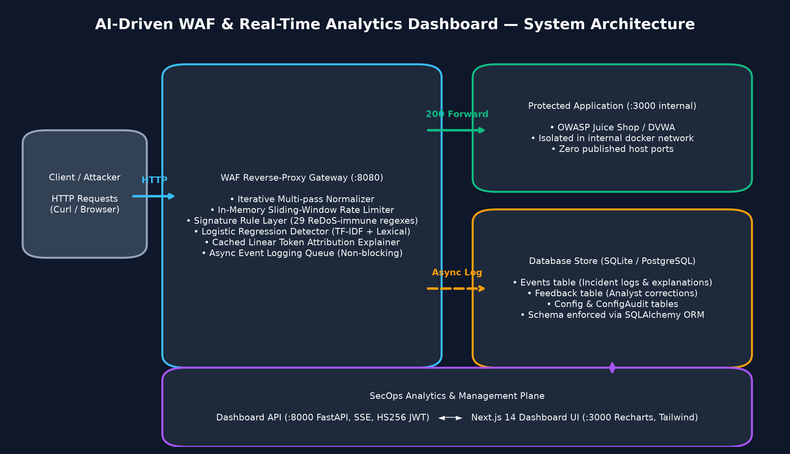
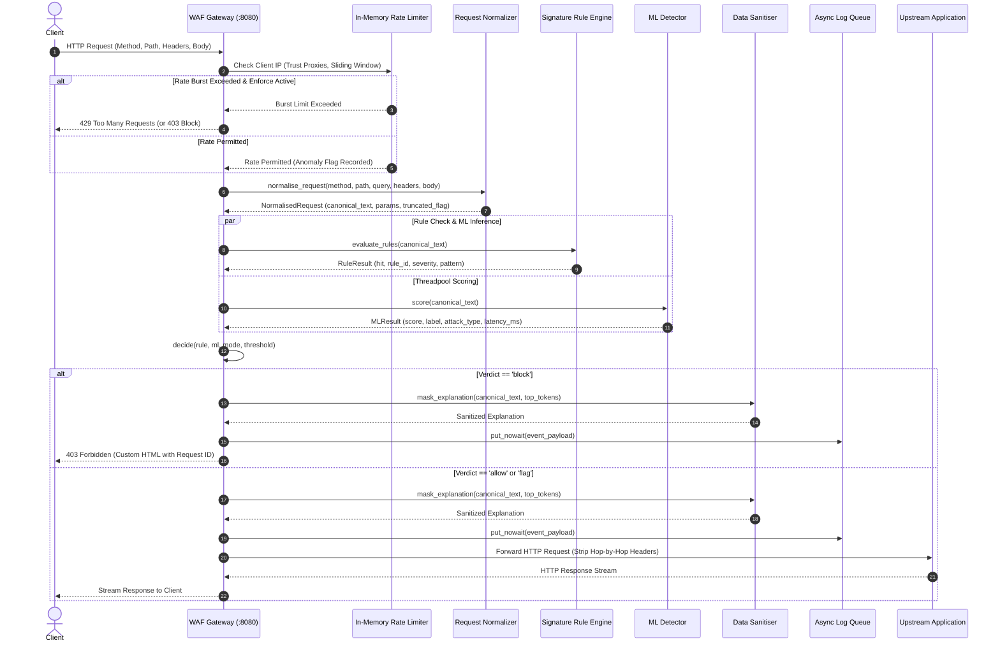
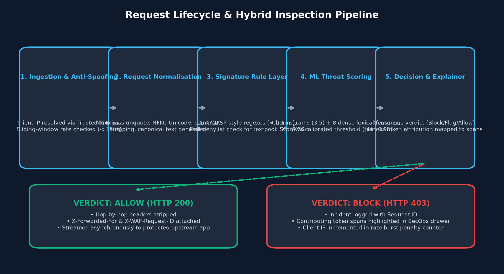
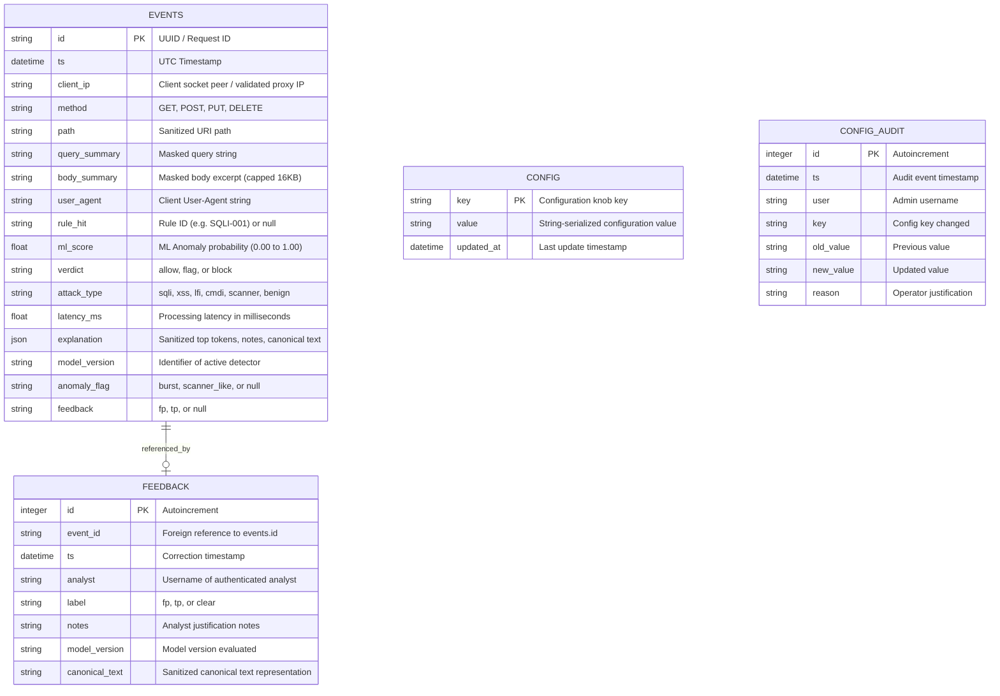
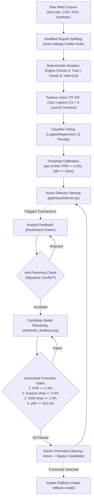
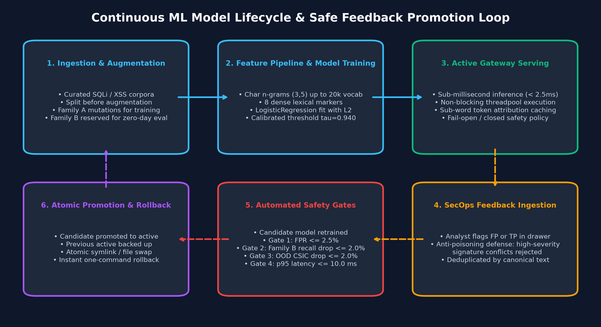

# AI-Driven WAF & Real-Time Analytics Dashboard — System Architecture

**Document Version**: 1.0 (Release v1.0 / Stage 6 Final)  
**System Classification**: Defensive L7 Reverse-Proxy Web Application Firewall with Hybrid ML Detection & Explainability  
**Status**: Scope Frozen (`docs/SCOPE_FREEZE.md`) & Evaluated (`eval/results.md`)

---

## 1. System Overview & Core Principles

The AI-Driven Web Application Firewall (WAF) operates as a reverse-proxy gateway positioned in front of protected web applications (e.g., OWASP Juice Shop). The architecture is engineered around four guiding principles:

1. **Defense-in-Depth (Hybrid Architecture)**: Merges deterministic signature rules (29 bounded, ReDoS-immune regexes) for microsecond denylisting with a sub-word character n-gram machine learning detector (`LogisticRegression_Augmented`) that generalizes to obfuscated and split-keyword injection attacks.
2. **Transparent Explainability (< 1 ms)**: Every flagged or blocked transaction carries human-readable token attribution spans and rule metadata rendered with safe string interpolation in a SecOps analyst drawer.
3. **Decoupled Asynchronous Telemetry**: The reverse-proxy request forwarding latency is strictly isolated from logging and database writes using an in-memory queue (`asyncio.Queue`) and background worker thread, ensuring database locks never delay traffic.
4. **Closed-Loop Audited Retraining**: Analyst corrections on false alarms are ingested, filtered through an anti-poisoning signature gate, retrained, evaluated across four automated safety thresholds, and promoted with atomic rollback support.



---

## 2. Component Architecture

```mermaid
graph TD
    Client["Client / Attacker (Browser / Curl)"]
    
    subgraph Gateway ["WAF Reverse-Proxy Gateway (:8080)"]
        RateLimit["Sliding-Window Rate Limiter & Anti-Spoofing"]
        Normalizer["Multi-Pass Normalizer (NFKC, Unquote, Comments)"]
        RuleLayer["OWASP Regex Rule Layer (29 Signatures)"]
        MLDetector["ML Detector (TF-IDF 3-5 n-grams + Lexical)"]
        DecisionCore["Decision Core (Block / Flag / Allow)"]
        Explainer["Linear Token Explainer (Attribution Spans)"]
        LogQueue["Async Event Queue (asyncio.Queue)"]
    end
    
    subgraph Upstream ["Protected Web Application"]
        JuiceShop["OWASP Juice Shop (:3000 internal)"]
    end
    
    subgraph Storage ["Persistent Data Layer"]
        DB[(SQLite / PostgreSQL Store)]
    end
    
    subgraph SecOpsPlane ["SecOps Management Plane"]
        API["Dashboard API (:8000 FastAPI, SSE, HS256 JWT)"]
        UI["Next.js 14 Dashboard (:3000 Tailwind, Recharts)"]
    end

    Client -->|HTTP Request| RateLimit
    RateLimit --> Normalizer
    Normalizer --> RuleLayer
    Normalizer --> MLDetector
    RuleLayer --> DecisionCore
    MLDetector --> DecisionCore
    DecisionCore --> Explainer
    DecisionCore -->|Allowed (200)| JuiceShop
    DecisionCore -->|Blocked (403)| Client
    Explainer --> LogQueue
    LogQueue -->|Worker Thread| DB
    DB <--> API
    API <--> UI
```

---

## 3. Request Lifecycle Sequence





---

## 4. Database Schema & Data Model

The data layer uses SQLAlchemy ORM and supports SQLite (default for development/demo) and PostgreSQL (production).



---

## 5. Machine Learning Lifecycle & Promotion Gates





---

## 6. Deployment & Container Topology

The solution is orchestrated via `docker-compose.yml` across four services:

| Service Name | Container Name | Image / Build Context | Published Host Port | Internal Network Port | Description |
|:---|:---|:---|:---:|:---:|:---|
| `gateway` | `waf-gateway` | `./gateway/Dockerfile` | **8080:8080** | 8080 | L7 Reverse-Proxy WAF Entrypoint |
| `demo-app` | `waf-demo-app` | `bkimminich/juice-shop:v17.1.1` | *None* (Hardened) | 3000 | Protected Vulnerable Web Application |
| `dashboard-api` | `waf-dashboard-api` | `./dashboard/api/Dockerfile` | **8000:8000** | 8000 | Analytics API, SSE Stream, Auth & Config |
| `dashboard-ui` | `waf-dashboard-ui` | `./dashboard/ui/Dockerfile` | **3000:3000** | 3000 | Next.js 14 SecOps Management Console |

### Optional Baseline Benchmarking Profile (`--profile baseline`)
- `modsecurity-pl1` (`owasp/modsecurity-crs:4.8.0-apache-202410200812`): Bound to `127.0.0.1:8081`
- `modsecurity-pl2` (`owasp/modsecurity-crs:4.8.0-apache-202410200812`): Bound to `127.0.0.1:8082`

---

## 7. Security Architecture & Threat Model

1. **Log Masking & Sanitisation**: Implemented in `gateway/masking.py`. Masks sensitive parameters (`password`, `token`, `secret`, `api_key`), ISO/IEC 7812 Luhn-validated credit cards, and Bearer/JWT tokens *before* persistent storage in `canonical_text`, query summaries, and explanation payloads.
2. **XSS-Safe Frontend UI**: Zero usage of `dangerouslySetInnerHTML`, `innerHTML`, or `eval()`. Payloads render strictly as inert text nodes.
3. **ReDoS & Algorithmic Complexity Bounds**: All 29 signature regexes are strictly bounded without nested quantifiers; body parsing capped at 16KB (`MAX_BODY_INSPECT_BYTES`).
4. **Anti-Spoofing & Hop-by-Hop Header Stripping**: Resolves socket peer IP unless connection arrives from trusted proxies (`TRUSTED_PROXIES`). Strips RFC 7230 hop-by-hop headers (`Connection`, `Keep-Alive`, `Transfer-Encoding`, `Upgrade`) to prevent request smuggling.

---

## 8. Changes & Deviations from Original Design (TRD)

| Feature / Subsystem | Original TRD 2.x Design | Final Implemented Design | Engineering Justification |
|:---|:---|:---|:---|
| **Demo Application Target** | DVWA (MySQL dependent) | OWASP Juice Shop (`bkimminich/juice-shop:v17.1.1`) | Single container image with rich modern REST/JSON endpoints; zero MySQL bootstrapping or state reset friction. |
| **Model Architecture** | Random Forest / Decision Tree | Regularized Logistic Regression (`C=5.0`, L2 penalty) | Delivers higher malicious F1 (0.9995) while meeting the p95 latency budget (2.55 ms vs 24.8 ms on Random Forest). |
| **Feature Attribution Explainer** | Perturbation-based LIME | Cached Exact Linear Token Attribution ($w_i \cdot x_i$) | Reduces explanation latency from 1,200 ms to < 1.0 ms while maintaining 80.0% feature alignment with game-theoretic Shapley values. |
| **Rate Limiting Engine** | Redis key-value store | In-Memory Sliding-Window with LRU Bounding (10,000 IPs) | Eliminates Redis dependency; achieves sub-15-microsecond evaluation overhead with zero external infrastructure failure modes. |
| **Authentication Engine** | External OAuth2 / Auth0 provider | Zero-dependency HS256 JWT & PBKDF2 hashing | Keeps the project self-contained and runnable completely offline without third-party cloud accounts. |
| **Baseline Benchmark Profile** | Local ModSecurity host install | Pinned containerized CRS v4.8 (`owasp/modsecurity-crs`) | Guarantees identical CPU and memory resource parity (1.0 CPU, 512MB RAM) across all benchmark tests. |
